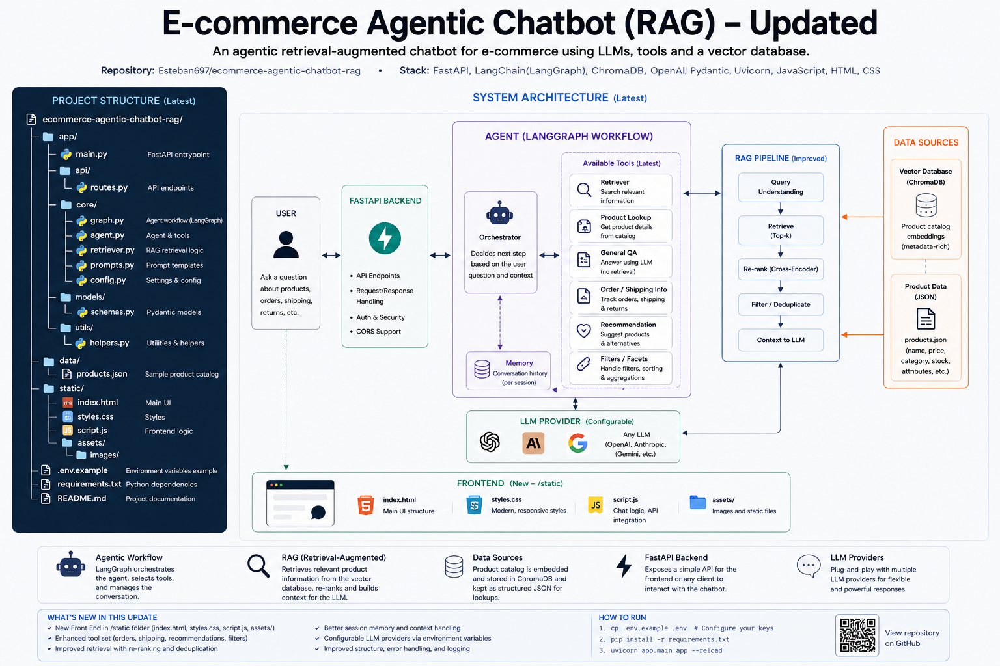
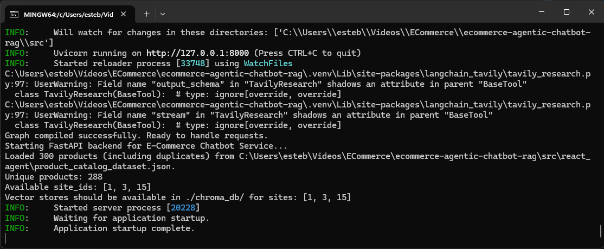

# E-Commerce Agentic Chatbot with RAG

## Overview

This is an intelligent e-commerce chatbot designed specifically for pet product recommendations. Built as a proof-of-concept for real company, the chatbot helps customers find relevant pet products through natural language conversations. It combines the reasoning capabilities of large language models with retrieval-augmented generation (RAG) to provide accurate, grounded product recommendations based on an actual product catalog rather than relying on the model's general knowledge.

The chatbot is built using LangGraph's ReAct (Reasoning and Action) agent pattern and exposes a FastAPI backend with RESTful endpoints. The system processes product catalog data by deduplicating entries, splitting products by site ID, creating semantic embeddings using OpenAI's text-embedding model, and storing them in site-specific ChromaDB vector databases. When a user asks a question, the agent uses semantic similarity search to retrieve the most relevant products from the vector store, then provides natural language recommendations grounded in the actual catalog data including product details, pricing, ratings, and stock availability.

Key features include site-scoped product search (ensuring users only see products from their specific shop), conversational memory that maintains context across multiple turns, multi-tool agent capabilities (with both web search via Tavily and local catalog search), and structured API responses that return both natural language answers and enriched product data for downstream applications. The architecture is designed to be scalable and extensible, with clear separation between data ingestion, embedding generation, vector storage, and the conversational agent layer.

## Architecture



(It may vary slightly as I am currently improving it...)

### API Endpoints

The API follows REST principles and uses versioned endpoints (v1) to ensure backward compatibility when breaking changes are introduced in future versions.

AI-assisted coding was able to put together an initial template of what the FastAPI Post method could look like.
Also, provided relevant code to de-duplicate the article-products in the dataset and a Mock to provide answers from that data when called.
Nevertheless, I added to the current structure of the React Agent template from LangChain to connect it to a relevant component that can act as ChatBot.

#### GET (/)
Root endpoint that returns basic API information, version, and documentation link.

#### GET (/v1/health)
A useful call to check that the API is running, that the model is able to respond to calls, which site IDs
can be used for the chatbot to have information about, and that the ingestion stage was able to sort the products
in the dataset provided.

**Response:**
```json
{
    "API_status": "Ok",
    "model_active": true,
    "sites_available": [1, 3, 15],
    "unique_products": 1234
}
```

#### POST (/v1/chat)
The actual exposed method to use the chatbot from any compatible application. It expects a specific JSON:

```
{
    "site_id": 
    "query":
    "conversation_id": optional
}
```

It accessed the graph built with LangGraph to be able to activate the agent that can process what is asked as 
Human message and use its tool (mainly RAG tool) to inspect if a product/s can match the request.
This process expects the agent to analyze the retrieve results from the dataset and produce an polite and useful
answer as it will be the expected string to be displayed in the chat for the end user.

The response has the following JSON structure:

```
{
    "answer": "string",
    "retrieved_products": []
    "conversation_id": optional
}
```

## Setup and Execution
The current solution can be easily deployment and tested with a Uvicorn server running locally and a couple of API keys for remote features (including of course the model).
NOTE: You can get different answer using different LLMs and even using the same one.

Follow the steps in your Git Bash terminal to configure the virtual environment to run the server and try the PoC:
- Navigate to the project path
```
cd /path/to/your/project/ecommerce-agentic-chatbot-rag
```

- Include these keys in your `.env` with the usual command so the virtual environment pull them with `load_dotenv()` when running `main.py`.
```
echo "API_KEY=your_secret_key_here" >> .env
```

- Create the virtual environment (named 'venv')
```
python -m venv venv
```

- Activate the virtual environment

Navigate to the virtual environment scripts directory and activate it:
```
cd [LOCAL_PROJECT_PATH].venv/Scripts
```

```
source activate
```

- **Run the data ingestion script (Required before first use)**

Before running the chatbot server for the first time, you must execute the data ingestion script. This prepares the product catalog data and creates the vector databases needed for the RAG feature:

```
python -m react_agent.ingest
```

This ingestion process will:
  - Load the product catalog from `product_catalog_dataset.json`
  - Deduplicate products and create separate JSON files for each `site_id`
  - Generate semantic embeddings using OpenAI's `text-embedding-3-small` model
  - Build and persist ChromaDB vector stores in `./chroma_db/` directory (one per site)

You should see terminal output showing the deduplication progress, site IDs found, and vector store creation for each site. This step only needs to be run once initially, or whenever you update the product catalog dataset.

- Start the chatbot server

Once data ingestion is complete, start the Uvicorn server:
```
python -m uvicorn react_agent.main:app --reload
```

You will see the loading and in your Git Bash terminal you will see the prints from the app showing what it happening in each step like this:



- Test the API

Open up the URL provided (typically `http://127.0.0.1:8000`) and add `/docs` to access the interactive API documentation (Swagger UI).

Navigate to the **POST /v1/chat** endpoint and click "Try it out". Copy the following test query and send it by pressing *Execute*
```
{
    "site_id": 1,
    "query": "Do you have dry food for a puppy with a sensitive stomach in your store?"
}
```


## Decisions and Trade-offs
Explain the key decisions you made in designing your agent and retrieval pipeline. What trade-offs did you consciously accept for the sake of this PoC, and what would you change or recommend for a production deployment?

The first big decision was the selection of the **React agent template from LangGraph** GitHub repos to enable the main chatbot features. This decision marries the PoC to the structure that LangGraph proposes but also brings lots of off-the-shelf benefits, like the distribution of responsibilities in the different python scripts in the project, ease of connection to other features in and out of the project, a json configuration file "langgrash.json" that can later be adapted to use LangSmith Studio for better observability of the agents performance, and more.
Also, a big pro in the list for LangGraph is the scalability of the current graph into more complex scenarios where the chatbot can produce sub-agents to complete other major procedure like doing a complete checkout for a user or just scaling the tools like a Agentic RAG instead of the current one.

The second big decision was to **split the dataset into site specific datasets** to avoid mixing product from other sites in the conversation. This basically from the assumption that a user will be accessing a single site in this search for the desired product and taking that user to another site is not within the possibilities for this chatbot. If this changing to a multi-site chatbot that can cross-reference products between them, that may cost a larger refactor to the way this tool is implemented. So it was a bit of an effort when unplugging the LLM from the large number of details in the dataset (as described in the diagram above), to avoid mixing products from one site into the other in the varios checks and searches that happen in the process. The downside is how it becomes less flexible to change sites within the same conversation or allowing to recommend products of the same original dataset but different sites from the current one.

The third decision was to **incorporate a conversation_id** value in the API request and responses generated by the application to enable a coherent conversation that can be decided as well by the Client side. The conversation thread can be kept consistent by the client repeating the id provided or providing another id provided before (even though that resets if the application resets because the conversation history is not saved externally yet). LangGraph provided options to enable memory between calls with "configurable threah Ids" that can keep track of the conversation (including tool calls) and that can be easily visible from LangSmith. I decided for a more straightforward solution that still kept the JSON structures proposed the in the assignment specs definition. Scalability and consistent state handling may have trouble with this, so it serves the purpose of PoC but not recommended for production.

## Future Roadmap

**Observability:** as mentioned above this project is not hard to connect to LangSmith where a whole suit of observability and testing tools are available. 

**Testing:** the different steps (especially the ones dealing with datasets) should include testing in different levels to check that things are runnig as expected. Also, depending on which integrations are added to this PoC, the corresponding tests should be included. The "\health" route implemented in the API is part of the effort to be able to test along the way of implementation.

**Scalability:** 
There are **two big concerns** when it comes to scalability:
**State handling:** Too many state handling attibutions to the API will make it harder to scale up allowing for several tenants. Better to move conversation memory and retrieved ID history out of process memory into Redis or a database, so the API becomes horizontally scalable. 

These are the parts that can be remove from process memory first:
    * conversation messages, retrieved product IDs, per-conversation site context, response summaries, optional user/session metadata.
That way the HTTP worker itself “forgets” everything after responding, even though the system still supports multi-turn chats.

**Latency:**
The LLM requests take some good time to be produced, especially when using the RAG pipeline retrieval so considering adding rate limiting, request tracing, and metrics on retrieval time, LLM time, and full-request latency, since scaling problems usually surface first as tail-latency issues rather than average latency issues.

For your current architecture, we can prioritize:
    * Shorten the system prompt and tool instructions, because every request pays that token cost.
    * Limit retrieved context aggressively, for example smaller k, shorter chunks, or a hard token budget on inserted context.
    * Use a faster model for most requests and reserve a slower, stronger model only for difficult cases.
    * Cache repeated or semantically similar results, especially for common catalog questions.

**Other concerns:**
**Startup and ingestion:** Ingestion runs at app startup so the API readiness becomes coupled to data preparation and embedding setup. That is manageable in development, but in production it hurts deploy speed, complicates autoscaling, and makes every new pod or worker repeat expensive initialization work. A big improvement we be keeping ingestion and vectorstore creation out of API startup, making them background jobs or deployment-time jobs.

**Additional features:** 
Storage is one big aspect that needs preparation before taking this PoC to production. **Changing the local storage solutions** picked for this PoC and making the cloud storage will be natural step to take for deployment of this solution. Remote embeddings like the one used here is one good example for what is needed, but the vector database can be an external resource to used for the RAG in production as well as the access to the JSON files. So that storage components replacement would be the first concern for moving all to the deployable and scalable infrastructure.

As mentioned above in the decisions, the **RAG pipeline can grow to become something more sophisticated.** A different datasets separation strategy can be implemented to include another global dataset that can be accessed as *site_0* or else. A different embedding can be chosen other than OpenAI's. A different vector storage can be selected to change Chroma (I needed to update the library from LangGraph dealing with this type of database because of obsolete code). And the overall RAG pipeline architecture can evolve into something more dynamic: like Agentic RAG where the information retrieved is check by the same or other LLMs that can prepate the data before sending it back to the chatbot agent.

The graph that already works for conversational flows with product catalog searches **can start incorporating more complex tools**. LangGraph architecture allows for changing all modular parts and growing the graph with extra nodes and extra agents if necessary. It is prepared for it so it shouldn't take a large effort to add one by one more features to it over time.


